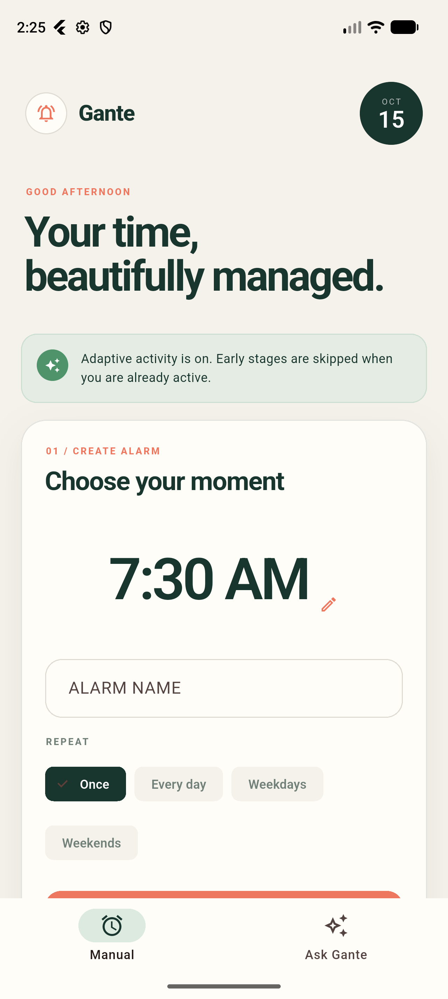
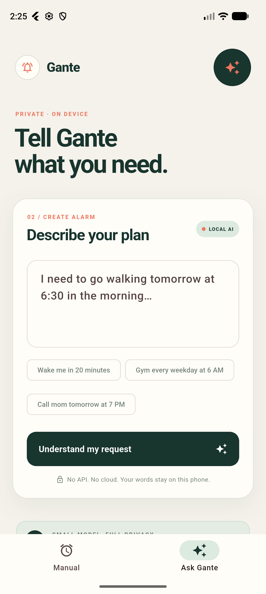
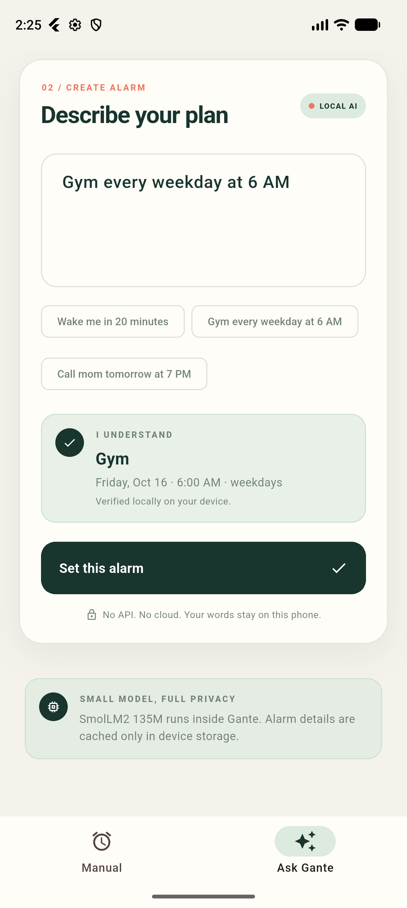

# Gante

**Offline alarms that understand what you have planned.**

Gante is a Flutter alarm app for Android and iOS. You can set a time manually or describe a reminder in plain English. For activities that take some preparation, Gante creates a wake-up plan with alerts before the time you need to be ready.

For example, “Gym every weekday at 6 AM” can become a weekday schedule with reminders at 5:30, 5:40, 5:50, 5:55, and 6:00. “Wake me in 20 minutes” stays a single alarm.

Everything runs on the device. There is no account, API key, or backend to configure.

[Screenshots](#screenshots) · [Features](#features) · [How it works](#how-it-works) · [Setup](#setup) · [Project structure](#project-structure) · [Development](#development)

## Screenshots

<table>
  <tr>
    <th>Set a time</th>
    <th>Describe a reminder</th>
    <th>Review before saving</th>
  </tr>
  <tr>
    <td></td>
    <td></td>
    <td></td>
  </tr>
</table>

Captured from Gante running on the Pixel 10 Pro Android emulator.

## Features

### Manual alarms

Choose a time, give the alarm a label, and select a repeat schedule: once, daily, weekdays, or weekends. Saved alarms can be edited, enabled, disabled, or deleted from the app.

### Plain-language requests

The Ask Gante screen accepts requests such as:

| Request | Result |
| --- | --- |
| “Wake me in 20 minutes” | A single alarm relative to the current time |
| “Call mom tomorrow at 7 PM” | A reminder for tomorrow evening |
| “Gym every weekday at 6 AM” | A recurring activity plan with preparation time |
| “Tomorrow I am a heavy sleeper and need to go to gym at 6 AM” | A wake-up plan with more frequent alerts |

Gante shows the interpreted request before saving it. Include a clock time or a duration; if it cannot determine a reliable time, it asks for one instead of creating an alarm with a guessed time.

### Wake-up plans

An activity's target time and its first alarm are different things. A gym session at 6 AM may require time to wake up and get ready. Gante represents that preparation as a list of alert offsets before the target time.

With 20 minutes of preparation, a normal plan has stages 30, 20, 10, 5, and 0 minutes before the activity. A heavy-sleeper plan uses repeated stages at the configured interval. A simple reminder uses only the target time.

Marking a plan complete with **I'm awake** cancels its remaining stages. Completed plans also contribute to local defaults for preparation time and the snooze interval used in future plans.

### Android integration

- **Shared text:** send text to Gante through Android's share menu or selected-text action, then choose when to be reminded.
- **Adaptive activity:** with optional usage access, one-time wake-up plans can skip early stages when another app was recently active. The final alert is still delivered through the normal alarm path.
- **Native scheduling:** one-time wake-up plans use Kotlin scheduling and receivers, so their alerts do not depend on keeping the Flutter screen open.

Sharing and activity-aware suppression are Android-specific. Repeating plans use the scheduled-notification path rather than the native adaptive path.

## How it works

### 1. Interpret the request locally

`LocalAiService` tries the deterministic `PromptParser` first. Common phrases for relative durations, clock times, repeat schedules, and activity preparation can be handled without starting a language model.

If the parser cannot resolve a request but an explicit time is present, Gante can use the bundled **SmolLM2 135M Instruct** model through `flutter_gemma` and the LiteRT-LM engine. The model runs on the CPU and returns structured fields such as the label, time, repeat schedule, preparation time, and wake style.

Model output is checked before it becomes an alarm draft. Invalid or incomplete output results in a request for clearer timing. The first request that needs the model copies its bundled asset into the app's private model store; straightforward parsed requests avoid that startup cost.

### 2. Preview and confirm

The interpreted request becomes an `AlarmDraft`. This contains the target date and time, repeat schedule, preparation time, snooze interval, and alert offsets. The preview shows the plan before the user confirms it.

Once confirmed, the app creates an `AlarmItem` with its own ID, enabled state, notification IDs, and completion status. Keeping notification IDs with each alarm allows edits, deletion, and completion to cancel the associated alerts.

### 3. Schedule with the operating system

`NotificationService` initializes timezone data, reads the device timezone, and requests the required permissions.

On Android, a one-time plan with multiple stages is sent to the native adaptive scheduler through a platform channel. Other alarms, including recurring plans, use `flutter_local_notifications`. Weekday and weekend schedules create notifications for the appropriate days, while daily schedules repeat by time.

Alert details vary by stage: early reminders are gentler, later stages use alarm-style notifications, and the final stage uses the strongest configured channel. Scheduled alerts can run while the app is closed; delivery still depends on the device's permissions and system settings.

### 4. Save alarms and preferences

`StorageService` serializes alarm records as JSON using `shared_preferences`, backed by Android SharedPreferences and iOS UserDefaults. It also stores an adaptive profile containing preparation minutes, snooze interval, and the number of completed-plan samples.

When a wake-up plan is completed, its preparation and snooze values contribute to running averages in that profile. This is a small local preference update; it does not retrain the language model.

Alarm requests, stored records, and inference stay on the device. The app has no remote inference or account service.

## Setup

### Requirements

| Component | Requirement |
| --- | --- |
| Flutter / Dart | A Flutter SDK with Dart 3.13.3 or a compatible later 3.x version, matching `pubspec.yaml` |
| Android | Android Studio, Android SDK, Java 17, and an Android 7.0+ device or emulator (API 24+) |
| iOS | macOS, Xcode, and an iOS 16.0+ device or simulator |

### Model asset

Before building, check that this file exists:

```text
assets/models/SmolLM2_135M_Instruct.litertlm
```

The model is approximately **143 MB** and is declared as a Flutter asset in `pubspec.yaml`, so it adds substantially to the app's download size. The build needs the actual model contents, not a Git LFS pointer file.

For a GitHub repository, keep this large binary in Git LFS or distribute it separately rather than committing it as an ordinary Git file.

### Run from Android Studio

1. Open the project root containing `pubspec.yaml` as a Flutter project.
2. Make sure the Flutter and Dart plugins are enabled and the Flutter SDK path is configured.
3. Fetch dependencies with **Pub get**, or run `flutter pub get` in the terminal.
4. Start an emulator from **Device Manager**, or connect an Android phone with USB debugging enabled and authorize the computer.
5. Select that device in the toolbar, open `lib/main.dart`, and click **Run**.

For setup problems, run:

```sh
flutter doctor -v
flutter doctor --android-licenses
```

### Run from the terminal

From the project root:

```sh
flutter pub get
flutter devices
flutter run -d <device-id>
```

Replace `<device-id>` with a device listed by `flutter devices`. With a single connected target, `flutter run` is enough.

### Permissions

Allow notifications so alarms can appear and play their configured sounds. On Android, also allow exact alarms when prompted. Usage access is optional and only needed for activity-aware suppression of early stages in one-time wake-up plans.

If an alarm does not arrive as expected, check these permissions and the phone's battery restrictions. Recurring plans and iOS notifications do not use Android's native activity-aware suppression.

### Build an Android APK

```sh
flutter build apk --release
```

The APK is written to:

```text
build/app/outputs/flutter-apk/app-release.apk
```

The current release configuration uses the debug signing key. Set up your own release signing before distributing a production build.

## Project structure

```text
lib/
  main.dart                         App theme, screens, and alarm management
  models/
    alarm.dart                      Saved alarms and draft plans
  services/
    local_ai_service.dart           Prompt parsing and on-device inference
    notification_service.dart       Permissions, timezones, and scheduling
    storage_service.dart            Local persistence and adaptive defaults
android/app/src/main/kotlin/com/gante/gante_app/
                                      Native sharing and adaptive alarms
ios/                                  iOS app configuration
assets/models/                        Bundled LiteRT-LM model
test/prompt_parser_test.dart          Parser and wake-up plan tests
```

The interface and app coordination currently live in `main.dart`. Parsing, storage, and notification handling are separate services, while Android-specific behavior is reached through platform channels.

## Development

Run static analysis and the existing tests from the project root:

```sh
flutter analyze
flutter test
```

The tests cover relative-time phrasing, weekday schedules, missing or unrelated times, interval alarms, preparation stages, and heavy-sleeper plans. They do not verify real-device notification delivery or language-model inference.

For changes to scheduling or native alarm behavior, also try a short alarm on a device with the app in the background. For parser changes, include the exact request and expected time in a regression test.

Bug reports should include the device, OS version, exact request or manual schedule, and what happened. For missed alerts, include the notification and exact-alarm permission settings.

